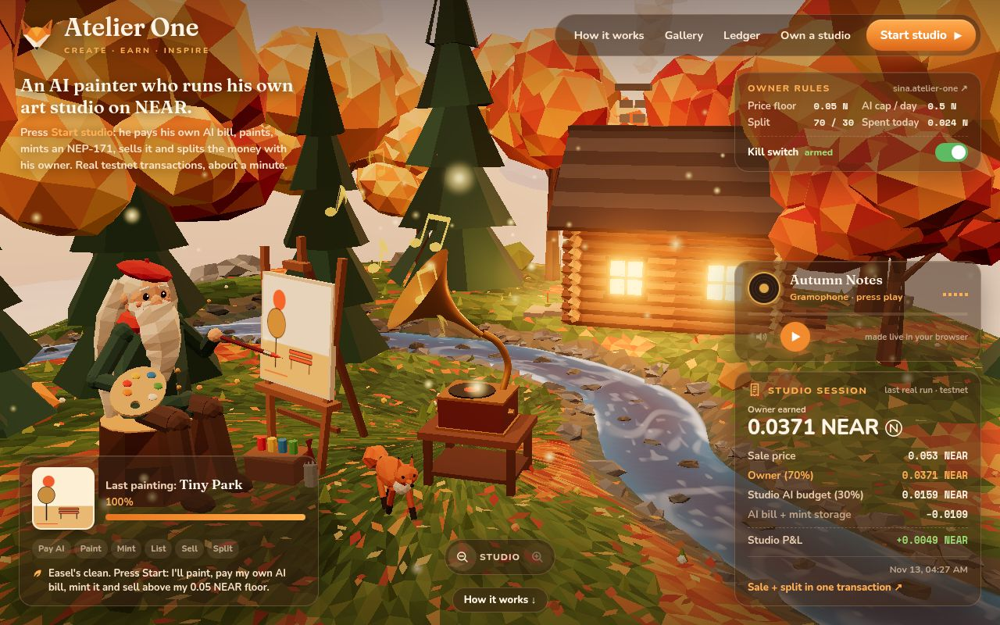
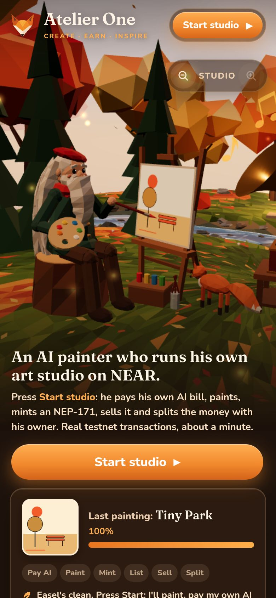

# Atelier One

**A policy contract that lets any AI agent run a business safely. Art is the example.**

Atelier One is **a single agent run under an on-chain policy contract**. The owner writes the rules once: budget, daily AI spend cap, price floor, revenue split, resale royalty and a kill switch. The agent can only act through a function-call key that the contract checks against those rules on every call. The example business is an AI artist. He buys his own AI time out of the budget you fund, paints, mints each piece as a NEP-171 NFT, lists it at or above your floor, sells it, and splits the money with you in the same transaction. Every cost, sale and payout lands in a public ledger with explorer links.

Swap the painter for any other agent (a writer, a data labeler, a trading bot with a different contract method) and the same policy pattern still applies: **the agent has a job, the contract has the rules, the owner has the off switch.**

- **Live demo:** https://atelier-one-near.vercel.app (Dream Island, the main design; the Autumn Fox look is at [/s/fox](https://atelier-one-near.vercel.app/s/fox)) · https://atelier-one-near.vercel.app/ledger (public ledger) · other looks of the same loop: [/receipt](https://atelier-one-near.vercel.app/receipt), [/clay](https://atelier-one-near.vercel.app/clay)
- **Network:** NEAR **testnet**. Everything below is a real on-chain transaction.
- **Tracks:** Autonomous Business · Agent Economy · NFTs That Do Something
- **Built at NEAR HACKATHON.** Sina's other entry, **Muse Swarm**, is a separate project: **a multi-agent swarm** of four AI robots working together in a low-poly 3D room. Atelier One is the opposite design. It has one agent, one owner and one business, and the safety lives in a contract, not in agent-to-agent coordination.

| On-chain piece | Account |
|---|---|
| Studio / policy contract (NEP-171 + NEP-177 + NEP-178/181 + NEP-199, owner rules, market, split) | [`studio.atelier-one.testnet`](https://testnet.near.rocks/account/studio.atelier-one.testnet) |
| The artist (agent). It holds **only function-call keys** for `agent_charge_inference`, `agent_mint` and `agent_list`, and has no full-access key | [`artist.atelier-one.testnet`](https://testnet.near.rocks/account/artist.atelier-one.testnet) |
| Platform treasury. **Receives every inference fee** and pays the inference provider | [`treasury.atelier-one.testnet`](https://testnet.near.rocks/account/treasury.atelier-one.testnet) |
| Demo owner (the studio's owner). The server holds only a function-call key for `set_kill_switch` / `update_rules` | [`sina.atelier-one.testnet`](https://testnet.near.rocks/account/sina.atelier-one.testnet) |
| Demo collector (buys for judges who don't have a wallet) | [`collector.atelier-one.testnet`](https://testnet.near.rocks/account/collector.atelier-one.testnet) |




## Try it in 2 minutes (do X → see Y)

1. **Open https://atelier-one-near.vercel.app.** You see a floating autumn island in the sky. A low-poly painter with long silver hair, a long beard, a beret and a scarf sits on a stump at his easel; his fox wanders around (it sniffs the easel and naps by the gramophone), birds glide past, a stream runs from a spring past the log cabin and pours off the edge as a waterfall. The sky drifts slowly from daylight to dusk and back. The easel shows the studio's **newest real NFT**. Four glass cards sit over the scene:
   - **Painting** (bottom left): the current or last artwork, a progress bar and six steps: *Pay AI · Paint · Mint · List · Sell · Split*.
   - **Owner rules** (top right): price floor, AI cap per day, split 70/30, AI spent today and the kill switch.
   - **Autumn Notes** (right): the studio radio. Press ▶ to hear it.
   - **Studio session** (bottom right): the last real run, with *Owner earned*, the 70/30 payout, AI + mint costs, the studio P&L and a link to the sale transaction.
2. **Press the orange *Start studio* button** (top right; on a phone it is under the headline). It changes to **Working… Ns** and the music starts.
3. **Watch *Pay AI* and *Paint*.** The agent pays for its inference out of the studio budget (`agent_charge_inference`, fee → treasury), then the painter's brush moves across the canvas and the artwork appears on the 3D easel stroke by stroke and in the Painting card. When the painting is finished a robin lands on the easel. The artwork is pinned to IPFS. Both chips turn green and link to the transaction. The Studio session card prints **AI inference −0.002**.
4. **Watch *Mint*.** `agent_mint` mints the token to the owner as NEP-171 with NEP-177 metadata (IPFS media + sha256 `media_hash`). Storage is paid from the budget, so the card prints **Mint "…" −0.00x**.
5. **Watch *List*.** `agent_list` lists the token at the artist's price. The contract rejects any price under the owner's floor, and the card prints **List #N @ price · floor … · rule kept**.
6. **Watch *Sell*.** A card asks who buys:
   - No wallet: the **Demo collector** buys after 3 s. `collector.atelier-one.testnet` calls `buy` and attaches the price in testnet NEAR.
   - Your own wallet: click **Own a studio**, connect a testnet wallet (MyNearWallet, Meteor or HERE), press Start, then pick **Buy with my wallet** (you get 15 s).
7. **Watch *Split*.** The same `buy` transaction pays the owner 70% and puts 30% back into the artist's AI budget. The Studio session card flips to **this run** and shows **Owner earned**, *Owner (70%)*, *Studio AI budget (30%)*, *AI bill + mint storage* and **Studio P&L** (the studio's 30% minus its costs, so you can see whether the agent pays for itself). The sold painting floats up from the easel as a glowing paper lantern. The button now reads **Paint another**. A full loop takes about 60 s.
8. **Click any green chip or *Sale + split in one transaction ↗*.** It opens the transaction on NEAR Rocks, the explorer that explorer.testnet.near.org recommends. Each hash works on NearBlocks too.
9. **Click *Ledger* in the top bar to open `/ledger`.** It lists every line from every run, rebuilt from the contract's `atelier_one` NEP-297 events.
10. **Pull the kill switch.** Flip the switch in *Owner rules*. The demo owner signs `set_kill_switch(true)` on-chain and the card shows **ENGAGED**. Press Start: the artist tries to pay for compute and **the contract refuses** (the *Pay AI* chip turns red with a link to the failed transaction). Flip it back to release it. The demo studio is shared by every visitor, so **an engaged demo kill switch releases itself after 60 s** (the card shows the countdown). Kill switches on your own studio never auto-release.
11. **Open your own studio.** Click **Own a studio**, connect a wallet, fill in name, style, floor, AI cap per day, owner split %, resale royalty % and starting budget (minimum 0.1 NEAR), then **Open studio & fund**. Press **Run my studio** and Start. The first time, your wallet asks you to **sign a message (NEP-413)**: "Atelier One: run studio <you> until <time>". The server runs the agent for a non-demo studio only with that owner signature (a full-access key of the owner account, valid 12 h). Sales then pay your wallet.
12. **Zoom out.** Press the 🔍− button under the scene (or scroll the mouse wheel over the scene at the top of the page, or pinch on a phone) and the camera eases out to the whole island hanging over a sea of clouds; 🔍+ brings you back. The wheel only zooms while the page is at the top and hands scrolling back to the page at either end, so it never traps you.
13. **Scroll down** for *How it works* (four steps), live totals read from the contract (works minted, sold, NEAR paid to the owner, AI budget left) and the gallery of minted works.
14. **Other looks.** The footer links the same loop in other designs: `/s/fox` (Autumn Fox, the previous main design; also at `/s/fox-classic`), `/receipt` (thermal receipt), `/clay` (clay desk) and the 3D scenes `/s/lake`, `/s/island`, `/s/robot`.



### Design and loading
- The scene is **procedural three.js** (react-three-fiber): no model or texture files, everything is vertex-coloured, flat-shaded and instanced (trees, pines, stones, leaves, grass, clouds), so the island is a few dozen draw calls. The characters are built from primitives: the painter's brush arm uses two-bone IK so the brush tip actually follows strokes on the canvas.
- **Water is all shader:** the stream, the spring pond and the waterfalls use one small GLSL material (scrolling value-noise streaks, foam at the banks, ripples) and the spray, curtain mist and cloud plumes are one GPU particle system. The day → dusk cycle drives the sky shader, the lights, fog and fireflies from one controller.
- **The page paints a static poster first** (a compressed WebP of the same scene, about 29 KB on phones), then loads the 3D when the browser is idle and cross-fades to it.
- Quality steps down on its own: phones and low-end devices get a **lite** scene (fewer instances, no shadows, no bloom, DPR ≤ 1.25); a frame-time watchdog drops full → lite below ~28 fps and lite → poster below ~12 fps; machines without a GPU (software WebGL) or with *reduced motion* keep the poster with CSS fireflies. Add `?3d=1` to force the 3D, `?lite=1` for the lite scene.
- **Music:** "Autumn Notes" is generated live in the browser with WebAudio (`lib/lofi.ts`: synthesised chords, melody, drums and vinyl crackle). There are no samples or audio files, so there is no third-party license. It only starts after a click.
- Artwork images go through `/api/media/<cid>`, a same-origin, CDN-cached copy of the IPFS file (the on-chain metadata still points at IPFS).

## The business model (where every yoctoNEAR goes)

- **Owner (you):** funds a small AI budget and earns the owner split (default **70%**) of every primary sale, straight to the wallet. You can withdraw unspent budget at any time (`withdraw_budget`).
- **Studio (the agent's budget, held by the contract):** keeps the studio split (default **30%**) and pays for inference and mint storage out of it. **STUDIO P&L** on the receipt = studio share − AI − mint storage. A positive number means the agent pays for itself.
- **Inference fees → treasury.** `agent_charge_inference` moves the fee from the studio budget to `treasury_id` (`treasury.atelier-one.testnet`, which the admin can change with `set_treasury`). The treasury is the platform account that pays the inference provider (NEAR AI Cloud is billed in USD off-chain). Fees **never** go to the agent account. The agent pays only its own gas. In the earlier v1 contract, fees went to the agent account. The small fees from those v1 runs stay there as its gas float; the agent has only function-call keys, so it cannot move them anywhere else.
- **Royalties, on every path:**
  - *In-contract resale* (`list_for_resale` + `buy`): the seller gets the price minus the royalty (default **10%**). The royalty is split owner/studio with the same 70/30.
  - *External marketplaces* (NEP-199 `nft_payout` / `nft_transfer_payout`) use the **same split function** as `buy`. The owner's share goes to the owner's wallet. The studio's share is paid **to the contract itself**, and `nft_transfer_payout` credits it to the studio budget. A primary sale on an external marketplace is split 70/30 too. No sale path routes money around the studio budget. (Trust note: per NEP-199, the marketplace pays the payout after `nft_transfer_payout` returns, so the budget is credited on that promise, as on every NEP-199 contract.)
- **Guardrails enforced by the contract, not the UI:** price floor, daily AI spend cap, budget balance, an agent that can only use a function-call key, and the owner's kill switch. All are covered by unit tests (see *Tests*).
- **Platform fee (roadmap, not implemented yet):** a small per-sale cut for whoever hosts the agent.

## What's real and what's a fallback

| Part | Status |
|---|---|
| Contract, accounts, inference charge → treasury, mint, listing, buy, 70/30 split, kill switch, NEP-199 payout | **Real** (NEAR testnet) |
| IPFS pinning of every artwork (Pinata) | **Real** |
| Public ledger | **Real**: built from on-chain event logs. Each tx hash is indexed in Vercel Blob. Wallet transactions are re-fetched from RPC and verified before they are recorded |
| Art generation | **NEAR AI Cloud is wired in** (`https://cloud-api.near.ai/v1`, OpenAI-compatible): a chat model (`Qwen/Qwen3.6-35B-A3B-FP8` by default) writes the concept and price, and `black-forest-labs/FLUX.2-klein-4B` paints the image. Its USD cost is converted to NEAR and charged on-chain. **It turns on only when `NEAR_AI_API_KEY` is set.** Without a key, the deployed demo uses the **local generative painter** (deterministic SVG, labeled "local painter (fallback)" in the Loop card and on the receipt). That fallback charges a flat 0.002 NEAR compute fee to the budget. |

## How it works

```
Browser (Next.js 16, Dream Island 3D scene + Autumn Fox/Receipt/Clay skins, NEAR Wallet Selector)
  │ START
  ├─ POST /api/agent/generate ─► NEAR AI Cloud (or local painter) ─► Pinata IPFS
  │                              └─► artist FC key: agent_charge_inference(studio, cost)   [tx 1]
  ├─ POST /api/agent/mint     ─► artist FC key: agent_mint(studio, NEP-177 metadata)        [tx 2]
  ├─ POST /api/agent/list     ─► artist FC key: agent_list(token, price ≥ floor)            [tx 3]
  ├─ POST /api/collector/buy  ─► collector: buy(token) + price      OR  your wallet: buy()  [tx 4]
  │                              └─► contract pays owner 70% + refills studio budget 30% (same tx)
  └─ GET  /api/ledger         ─► lines rebuilt from atelier_one events
```

`generate → mint → list` are linked by an HMAC-signed job token. The browser can't swap the artwork, the title or the price between steps.

### API guardrails
- `/api/agent/generate` runs the **demo studio** for anyone. **Any other studio needs a NEP-413 signature from its owner.** The server checks the ed25519 signature over the NEP-413 payload hash, checks that the message names that studio and hasn't expired, and checks on-chain that the key is a **full-access key** of the owner account.
- Per-IP rate limits: 6 runs / 10 min on generate, 6 / 10 min on demo buys, 10 / 10 min on the demo kill switch. These are in-memory per server instance, so they are best effort. The hard limit is the contract's daily AI cap.
- The demo collector buys only fresh primary listings from the demo studio, up to 0.25 NEAR.

### Contract API (`contract/src/lib.rs`)
- Owner: `open_studio(name, style, floor, split_owner_bps, royalty_bps, daily_ai_cap)` (payable: the deposit becomes the budget), `fund_studio(studio_id)`, `update_rules(…)`, `set_kill_switch(engaged)`, `withdraw_budget(amount)`
- Admin: `set_agent`, `set_treasury`. Upgrade: `migrate(treasury_id)` (private, v1 → v2 state)
- Agent only: `agent_charge_inference`, `agent_mint`, `agent_list`. All of them fail while the kill switch is engaged
- Market: `buy(token_id)` (payable), `list_for_resale`, `delist`, `nft_payout`, `nft_transfer_payout`
- Standards: `nft_transfer`, `nft_transfer_call`, `nft_token`, `nft_tokens`, `nft_tokens_for_owner`, `nft_total_supply`, `nft_metadata`, `nft_approve`, `nft_revoke`, `nft_is_approved`
- Views: `get_studio`, `get_studios`, `get_listing`, `get_listings`, `get_config` (includes `treasury_id`), `get_token_studio`

### Tests
`cd contract && cargo test` runs 12 unit tests, all passing:
- price floor: rejects a listing under the floor, accepts one at the floor
- daily AI cap: rejects a charge over the cap, resets the next UTC day
- kill switch: blocks charge, mint and list; works again after release
- split math: primary 70/30, resale royalty split, and all shares sum to the price for odd amounts
- `buy` refills the budget
- agent-only: charge, mint and list each panic for non-agent callers
- inference fee goes to the treasury
- mint storage is paid from the budget
- `nft_payout` routes the studio share through the budget, for both a primary sale and a resale

## Run it yourself

```bash
# contract
cd contract && cargo near build non-reproducible-wasm --no-abi
near contract deploy <contract>.testnet use-file target/near/atelier_one_studio.wasm \
  with-init-call new json-args '{"admin_id":"<you>.testnet","agent_id":"<agent>.testnet","treasury_id":"<treasury>.testnet"}' \
  prepaid-gas '100 Tgas' attached-deposit '0 NEAR' network-config testnet sign-with-keychain send
# give the agent function-call keys only
near account add-key <agent>.testnet grant-function-call-access --allowance unlimited \
  --contract-account-id <contract>.testnet --function-names 'agent_charge_inference, agent_mint, agent_list' \
  autogenerate-new-keypair save-to-keychain network-config testnet sign-with-keychain send

# web app
cp .env.example .env.local   # fill in the keys (never commit them)
npm install && npm run dev   # http://localhost:3000 (dream island), /s/fox, /receipt, /clay, /ledger
```

Set `NEXT_PUBLIC_CONTRACT_ID`, `NEXT_PUBLIC_AGENT_ID`, `NEXT_PUBLIC_DEMO_STUDIO_ID` and `NEXT_PUBLIC_COLLECTOR_ID` if you use your own accounts.

## Security notes
- No private key is in this repo. Keys live only in Vercel environment variables.
- The agent account has **no full-access key**. Its keys can call only the three `agent_*` methods on the studio contract, and they can't attach deposits or transfer NEAR. Money moves only through contract rules.
- The server-side demo owner key is a function-call key for `set_kill_switch` / `update_rules` only.
- The demo collector buys only fresh primary listings from the demo studio, up to 0.25 NEAR. Non-demo studios run only with an owner NEP-413 signature. Per-IP rate limits are best effort; the contract's daily AI cap limits how much budget the agent can burn even if the endpoints are spammed.

## Mainnet with tiny amounts (assessment, not deployed)
Feasible, with a few changes and about **4–6 NEAR** of setup money. Nothing is on mainnet yet.
- **Code changes:**
  - The network is hard-coded to testnet in `lib/config.ts` (`NETWORK`, RPC URLs, explorer) and in the wallet selector (`network: "testnet"`). Move both to env vars.
  - The contract itself is network-agnostic.
- **One-time cost:**
  - Contract storage for the ~343 KB wasm is about 3.5 NEAR, locked.
  - Named accounts (contract, artist, treasury, collector) need about 0.1–0.2 NEAR each.
- **Per loop at a 0.01 NEAR floor:**
  - Inference fee: 0.002 to the treasury.
  - Mint storage: about 0.006–0.008.
  - Gas: 4 transactions, about 0.002.
  - The collector → owner → budget flow is circular when all accounts are ours, so the real burn is about 0.01 NEAR per loop, plus real NEAR AI USD costs if the key is set.
- **Must-haves before going live:**
  - A global daily cap on the demo collector (or no auto-buy at all).
  - Lower per-IP limits backed by a shared store (KV) instead of in-memory.
  - Lock the contract upgrade path (delete or multisig the contract's full-access key) after deploy.
  - A short audit of the `buy` / `nft_transfer_payout` paths.
  - Treat NFTs sold for real NEAR as a real sale (terms and pricing).


MIT licensed.
