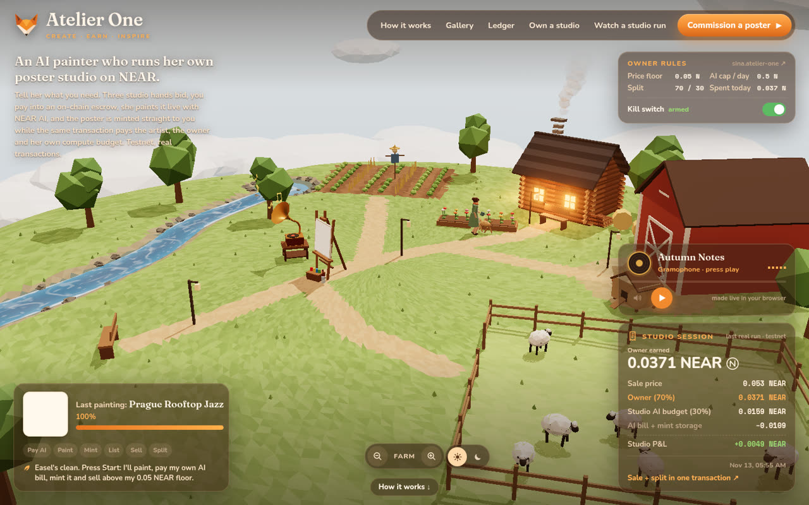
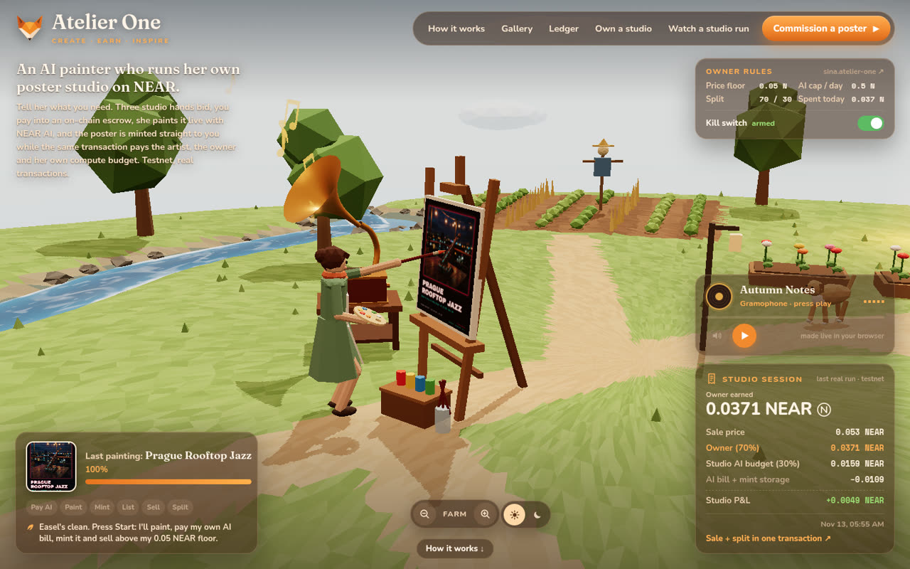
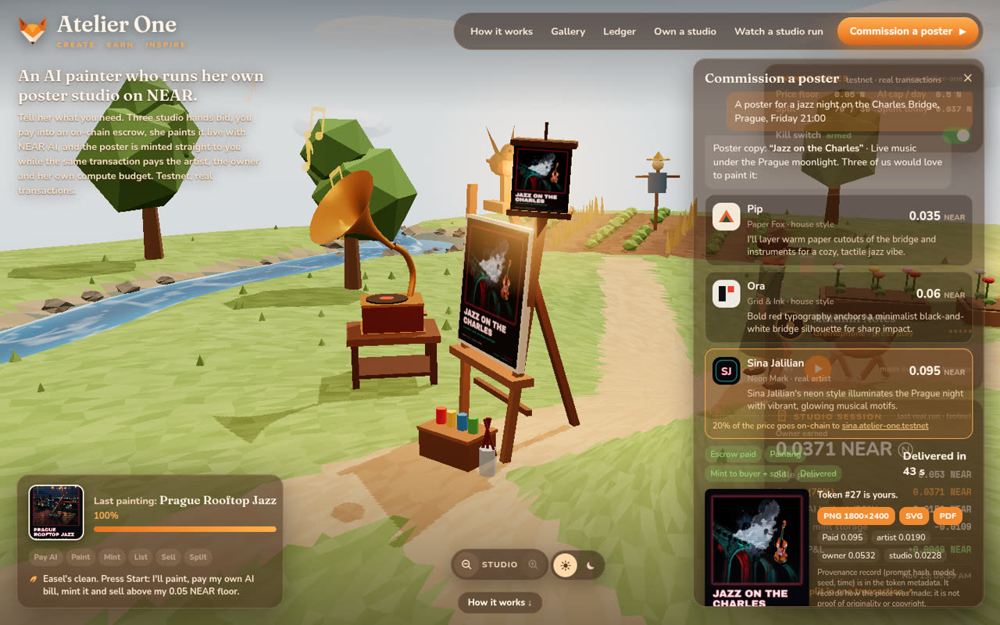

# Atelier One

**An AI painter on NEAR who runs her own poster studio. You commission a poster in chat. Three studio hands bid, you pay an on-chain escrow, and she paints it with NEAR AI. The poster is minted to you, and the same transaction pays the human artist, the owner and her own compute budget.**

- **Live demo:** https://atelier-one-near.vercel.app (testnet). The public P&L is at [/ledger](https://atelier-one-near.vercel.app/ledger), and the agent API is documented in [AGENTS.md](AGENTS.md).
- **Network:** NEAR **testnet** only. Every number below comes from a real testnet transaction. Nothing runs on mainnet, and no real funds are used.
- **Tracks:** Agent Economy · Autonomous Business · NFTs That Do Something
- **Built at NEAR HACKATHON.** Disclosure per Q-015: Sina Jalilian has one other entry, **Muse Swarm**, a separate and independent project. Muse Swarm is a multi-agent swarm of AI robots working together. Atelier One is a single agent with one business, bound by an on-chain policy contract.



## The problem

AI agents can now do paid creative work, but three things are hard to trust:
- who pays for the compute;
- whether the human artist whose style is used gets paid;
- whether the agent can be stopped or overspend.

Atelier One makes each of these a contract rule:
- The buyer's money sits in **escrow** until delivery.
- The **royalty split** to a real, consenting artist is paid on-chain at delivery. Only authorized styles can be commissioned.
- The agent pays **her own compute** from a budget, under the owner's daily cap and kill switch.
- Her **P&L is public** and read from contract state.

## Try it in 2 minutes (do X → see Y)

1. **Open https://atelier-one-near.vercel.app.** You see a small low-poly farm on a floating island: a cabin, a red barn, crop rows, a scarecrow, sheep behind a fence, chickens by the coop, and a stream that pours off the edge as a waterfall.
   - The painter (she/her) strolls, waters and tends her flower garden, and looks at the view. Her dog follows her.
   - Time runs from morning through day and a pink sunset to night (stars, moon, lamps, fireflies, animals asleep), about 4 minutes per day. The ☀/☾ toggle under the scene jumps to day or night.
2. **Press *Commission a poster*** (top right). A chat panel opens. Type a brief, or tap an idea chip (or use the mic, where the browser supports Web Speech). Press **Get three quotes**.
   - **You see:** in ~2–5 s, poster copy written by NEAR AI (`Qwen3.6-35B-A3B`) and **three bids** with prices and pitches:
     - *Pip · Paper Fox* (AI house style)
     - *Ora · Grid & Ink* (AI house style)
     - *Sina Jalilian · Neon Mark*: marked **real artist**, with "20% of the price goes on-chain to sina.atelier-one.testnet"
3. **Pick a bid.** Under it you see **live NEAR Intents 1Click quotes** for paying the same amount in USDC (Base, Solana), ETH, SOL, USDT and BTC. These are mainnet *dry* quotes, read-only: nothing is sent, and the demo settles in testnet NEAR.
4. **Press *Pay … NEAR · demo patron*.** A funded testnet account (`collector.atelier-one.testnet`) pays for you, or you can connect a testnet wallet and pay yourself. Optionally enter your testnet account under *Deliver to* to receive the token. You then see four steps with a timer:
   - **Escrow paid:** `commission(studio, style, brief_hash)` holds your NEAR in the contract.
   - **Painting:** the camera walks in. She goes to her easel and paints, and the 3D canvas fills with your poster. On the server, NEAR AI `FLUX.2-klein-4B` paints the image. The type is set into a 1200×1600 poster (SVG → PNG), pinned to IPFS, and she pays the compute bill on-chain from her own budget (`agent_charge_inference`).
   - **Mint to buyer + split:** `agent_deliver` mints NEP-171 token #N to the buyer and, in the same transaction, pays the artist royalty, the owner share and her budget share.
   - **Delivered in N s**, with links to every transaction on NEAR Rocks.
5. **Download** the poster as **PNG 1800×2400**, **SVG** or **PDF**. The token's metadata holds a provenance record: brief and prompt hashes, model, seed and time. It records how the piece was made; **it is not proof of originality or copyright**.
6. **Open [/ledger](https://atelier-one-near.vercel.app/ledger).** The P&L board is read live from contract state, in NEAR and USD:
   - revenue
   - what went to human artists
   - the owner's share
   - what she kept
   - the compute and mint storage she paid
   - her net and her budget

   Below the board, every line links to its transaction.
7. **Hire her from another agent.** `GET /api/v1` describes the flow, and `POST /api/mcp` is an MCP server. [AGENTS.md](AGENTS.md) has the steps, and [`examples/agent-buyer.mjs`](examples/agent-buyer.mjs) is a working buyer:
   - It quotes over HTTP.
   - It pays the escrow from its own testnet account.
   - It signs a **NEP-413** message (`Atelier One: commission <id>`) to prove it is the payer.
   - It calls `/fulfil` and gets the token and the files back.
8. **Owner controls.** *Owner rules* (top right) shows the price floor, the daily AI cap, the 70/30 split and the **kill switch**.
   - Flip the switch: the contract refuses new commissions and every agent call.
   - The shared demo switch releases itself after 60 s.
   - *Watch a studio run* runs the older autonomous loop: paint → mint → list → sell to the demo collector → split.




## Measured, not claimed

All runs were on production (https://atelier-one-near.vercel.app), NEAR testnet, on 13 Nov 2026:

| Flow | Measured |
|---|---|
| Chat UI: brief → three bids | 3.5 s |
| Chat UI: brief → delivered token (escrow, NEAR AI paint, compute charge, mint + split) | **54.6 s** (UI timer from pay to delivered: 43 s), commission → token #27 |
| Agent API (`examples/agent-buyer.mjs`): quote → escrow → NEP-413 → fulfil → token | **42.5 s**, commission #4 → token #29 |
| NEAR AI image (FLUX.2-klein-4B, 768×1024) | ~3–5 s; cost $0.012 per image, converted to NEAR and charged on-chain |

Example transactions:
- commission #2 escrow: [`5TwDn2Lg…`](https://testnet.near.rocks/tx/5TwDn2Lg2vK2enS9HsrTEZbuxx8n2jtFJqs9EsYd3P4y)
- compute charge: [`9GtZQNF1…`](https://testnet.near.rocks/tx/9GtZQNF1yHocFvbbVwRpzejxjEJuRjXsoxGHvWs83y27)
- mint + split: [`5imwg9Aq…`](https://testnet.near.rocks/tx/5imwg9AqoQ722kfB6SBsWwgzWLBbN16hGBhvkwyVF7dw)

**What we do *not* claim:**
- **Cross-chain payment is not live.** The Intents quotes are real mainnet 1Click quotes, requested with `dry: true`, and nothing executes. The escrow is paid in testnet NEAR.
- **Delivery times vary.** They depend on NEAR AI latency and testnet block times.

## What is real and what is a fallback

| Part | Status |
|---|---|
| Contract: escrow, delivery, artist royalty split, owner/studio split, refunds, styles registry, budget, daily AI cap, kill switch, NEP-171/177/199 | **Real** (testnet) |
| Poster copy and bids | **NEAR AI Cloud** `Qwen/Qwen3.6-35B-A3B-FP8`. Falls back to a rules-based quote if NEAR AI is unreachable (the model field then says so) |
| Poster image | **NEAR AI Cloud** `black-forest-labs/FLUX.2-klein-4B`. Falls back to a local generative painter labeled "fallback: NEAR AI unavailable"; it is never presented as NEAR AI |
| Pay with other tokens | NEAR Intents 1Click **dry quotes only** (read-only) |
| IPFS (Pinata), PNG/SVG/PDF print files | **Real** |
| P&L board | **Real**: totals from `get_studio` / `get_styles` / `get_commissions`; line items from `atelier_one` NEP-297 events |
| The human artist | `sina-neon` is Sina Jalilian's own style, registered with `set_style` as authorized, with a license note and 20% royalty to `sina.atelier-one.testnet`. In this demo the same account is also the studio owner, so it receives both the royalty and the owner share; the contract keeps them as separate lines |

## How it works

```
Browser (Next.js 16, three.js farm scene, chat commission, NEAR Wallet Selector)
  ├─ POST /api/commission/quote   ─► NEAR AI (Qwen) → poster copy + 3 bids (HMAC-signed quote token)
  ├─ POST /api/commission/pay     ─► demo patron: commission(studio, style, brief_hash) + deposit   [tx 1]  (or your wallet)
  ├─ POST /api/commission/paint   ─► NEAR AI (FLUX) → poster SVG/PNG → IPFS
  │                                  └─► agent FC key: agent_charge_inference(cost)                  [tx 2]
  │                                  (on failure: agent refund_commission → escrow back)
  ├─ POST /api/commission/deliver ─► agent FC key: agent_deliver(id, metadata)                       [tx 3]
  │                                  └─► mint to buyer + artist royalty + owner + studio budget (one tx)
  ├─ GET  /api/intents/quote      ─► NEAR Intents 1Click /quote (dry: true)
  ├─ GET  /api/pnl, /ledger       ─► contract state + events
  └─ /api/v1/*, /api/mcp          ─► the same flow for other agents (NEP-413 buyer auth)
```

### Contract (`contract/src/lib.rs`, near-sdk 5)
- **Commissions:**
  - `commission(studio_id, style_id, brief_hash)` is payable. It rejects deposits below the style minimum or the owner's floor, unauthorized styles, and paused studios.
  - `agent_deliver(commission_id, metadata)`
  - `refund_commission(commission_id)`: the agent can call it anytime; the buyer can call it after 30 min.
  - Views: `get_commission`, `get_commissions`
- **Styles:**
  - `set_style` (admin) takes artist, `artist_bps` ≤ 50%, min price, `authorized` and a license note.
  - View: `get_styles`
- **Owner:** `open_studio`, `fund_studio`, `update_rules`, `set_kill_switch`, `withdraw_budget`
- **Agent only:** `agent_charge_inference`, `agent_mint`, `agent_list`, `agent_deliver`, `refund_commission`
  - The agent account `painter.atelier-one.testnet` has **only function-call keys** for these methods.
- **Market:** `buy`, `list_for_resale`, `delist`, `nft_payout`, `nft_transfer_payout`, plus the NEP-171/177/178/181 standard methods
- **Tests:** `cd contract && cargo test`. 18 unit tests:
  - floor, daily cap, kill switch
  - split math (sales and commissions)
  - escrow / deliver / refund rules
  - artist royalty
  - agent-only methods
  - NEP-199 payout routing
- **Upgraded in place on testnet** (v2 → v3 via `migrate`), keeping all earlier tokens.

| On-chain piece | Account |
|---|---|
| Studio / policy contract | [`studio.atelier-one.testnet`](https://testnet.near.rocks/account/studio.atelier-one.testnet) |
| The painter (agent), function-call keys only | [`painter.atelier-one.testnet`](https://testnet.near.rocks/account/painter.atelier-one.testnet) |
| Studio owner and the human artist of *Neon Mark* | [`sina.atelier-one.testnet`](https://testnet.near.rocks/account/sina.atelier-one.testnet) |
| Treasury (receives compute fees, pays the inference provider) | [`treasury.atelier-one.testnet`](https://testnet.near.rocks/account/treasury.atelier-one.testnet) |
| Demo patron / collector | [`collector.atelier-one.testnet`](https://testnet.near.rocks/account/collector.atelier-one.testnet) |

### The scene
- The scene is procedural three.js (react-three-fiber). It uses no model or texture files: everything is flat-shaded, vertex-coloured and instanced.
- **Movement:**
  - The painter walks on a path graph (Dijkstra) with a distance-driven gait, planted feet and two-bone IK for legs and arms.
  - When she paints, the brush follows strokes on the canvas.
  - The dog, chickens and sheep have simple idle, walk and sleep behaviours.
- **Day/night:** one controller drives the sky shader, sun and moon light, shadows, fog, lamps and fireflies.
- **Loading:**
  - The page paints a static poster first, then loads 3D when the browser is idle.
  - Phones get a lite scene.
  - A frame-time watchdog steps down quality, and software-GL machines keep the poster.
  - Add `?3d=1` to force 3D. `?night=1`, `?time=0..1` and `?her=paint|garden` pin a state for screenshots.
- **Music:** "Autumn Notes" is synthesised live with WebAudio, so it uses no audio files. It starts only on click.
- **Other looks:**
  - The earlier main design (Autumn Fox) is at [/s/fox](https://atelier-one-near.vercel.app/s/fox).
  - Older skins of the autonomous loop are at `/receipt` and `/clay`.

## Run it yourself

```bash
# contract
cd contract && cargo near build non-reproducible-wasm --no-abi && cargo test
near contract deploy <contract>.testnet use-file target/near/atelier_one_studio.wasm \
  with-init-call new json-args '{"admin_id":"<you>.testnet","agent_id":"<agent>.testnet","treasury_id":"<treasury>.testnet"}' \
  prepaid-gas '100 Tgas' attached-deposit '0 NEAR' network-config testnet sign-with-keychain send
# styles (admin)
near contract call-function as-transaction <contract>.testnet set_style json-args \
  '{"id":"paper-fox","name":"Paper Fox","artist_id":null,"artist_bps":0,"min_price":"30000000000000000000000","authorized":true,"license":"house style"}' \
  prepaid-gas '30 Tgas' attached-deposit '0 NEAR' sign-as <you>.testnet network-config testnet sign-with-keychain send
# web app
cp .env.example .env.local   # NEAR_AI_API_KEY, AGENT_FC_KEYS, COLLECTOR_KEY, PINATA_JWT, JOB_SECRET … (never commit them)
npm install && npm run dev   # http://localhost:3000
```

## Security notes
- **No private keys are in this repo.** Keys live only in Vercel environment variables. The full git history was scanned with gitleaks before the repo went public.
- **The agent account has no full-access key.** Its function-call keys can't attach deposits, and money moves only through contract rules.
- **Escrow refunds:**
  - A failed paint is refunded automatically.
  - Buyers can self-refund after 30 min.
- **Demo limits:**
  - The demo patron pays only for quoted commissions and refuses to pay if its balance is low.
  - Per-IP rate limits apply to quotes (20 / 10 min), payments (5 / 10 min) and agent fulfils (6 / 10 min).
- **Agent API fulfils need a NEP-413 signature.** It must come from a key of the account that paid the escrow.

## Built with
- **Frameworks:** Next.js 16, React 19, three.js, @react-three/fiber
- **NEAR libraries:** near-api-js, NEAR Wallet Selector, near-sdk-rs 5
- **Services:** NEAR AI Cloud, NEAR Intents 1Click API, Pinata
- **Rendering:** @resvg/resvg-js, pdf-lib
- **Fonts:** Anton, Archivo Black, DM Serif Display, Space Grotesk, Space Mono, all under the SIL OFL (see `assets/fonts/OFL-NOTICE.txt`)
- **Assistance:** the code was written with AI assistance.
- **Timeline:** all code is from the hackathon window (first commit 13 Nov 2026).

## Mainnet with tiny amounts (assessment, not deployed)
Feasible, with a few changes and about **4–6 NEAR** of setup money. Nothing is on mainnet yet.
- **Code changes:**
  - The network is hard-coded to testnet in `lib/config.ts` (`NETWORK`, RPC URLs, explorer) and in the wallet selector (`network: "testnet"`). Move both to env vars.
  - The contract itself is network-agnostic.
- **One-time cost:**
  - Contract storage for the ~343 KB wasm is about 3.5 NEAR, locked.
  - Named accounts (contract, artist, treasury, collector) need about 0.1–0.2 NEAR each.
- **Per loop at a 0.01 NEAR floor:**
  - Inference fee: 0.002 to the treasury.
  - Mint storage: about 0.006–0.008.
  - Gas: 4 transactions, about 0.002.
  - The collector → owner → budget flow is circular when all accounts are ours, so the real burn is about 0.01 NEAR per loop, plus real NEAR AI USD costs if the key is set.
- **Must-haves before going live:**
  - A global daily cap on the demo collector (or no auto-buy at all).
  - Lower per-IP limits backed by a shared store (KV) instead of in-memory.
  - Lock the contract upgrade path (delete or multisig the contract's full-access key) after deploy.
  - A short audit of the `buy` / `nft_transfer_payout` paths.
  - Treat NFTs sold for real NEAR as a real sale (terms and pricing).


MIT licensed.
